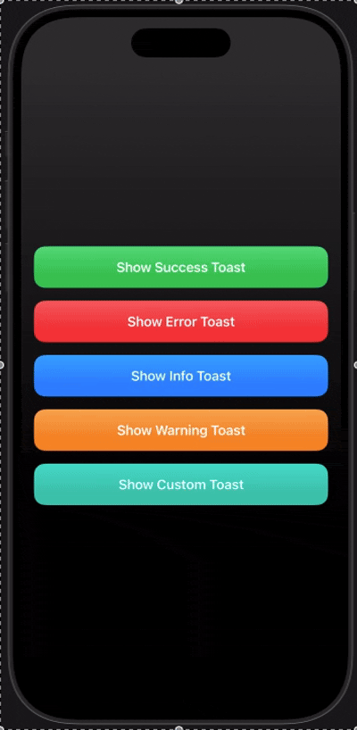

# DynamicIslandToast

A SwiftUI toast that morphs out of the Dynamic Island. It adapts to the device: devices with a Dynamic Island get the pill-morph animation, notch devices get a full-width drop-down, and home-button devices get a slide-down banner.

<p align="center">
  
</p>

## Features

- Pill-to-card morph animation from the Dynamic Island
- Automatic fallback for notch and non-notch iPhones
- Built-in types: `success`, `error`, `info`, `warning`, plus `custom(color:icon:)`
- Optional tint gradient behind the toast
- Swipe up to dismiss
- Presents in its own window, above sheets, full-screen covers and alerts
- Touches pass through to your app while the toast is showing
- Back-to-back toasts swap smoothly

## Requirements

- iOS 17.0+
- Swift 5.9+
- Xcode 15+

## Installation

### Swift Package Manager

In Xcode: **File > Add Package Dependencies...** and enter:

```
https://github.com/<your-username>/DynamicIslandToast
```

Or add it to your `Package.swift`:

```swift
dependencies: [
    .package(url: "https://github.com/<your-username>/DynamicIslandToast", from: "1.0.0")
]
```

## Usage

Import the package and call the shared manager from anywhere on the main actor. No setup in your view hierarchy is needed; the window is created on first use.

```swift
import SwiftUI
import DynamicIslandToast

struct ContentView: View {
    var body: some View {
        VStack(spacing: 16) {
            Button("Show Success Toast") {
                DyanmicIslandToastManager.shared.show(
                    IslandModel(
                        title: "Success",
                        message: "Your changes have been saved.",
                        type: .success
                    )
                )
            }

            Button("Show Error Toast") {
                DyanmicIslandToastManager.shared.show(
                    IslandModel(
                        title: "Error",
                        message: "Something went wrong.",
                        type: .error
                    )
                )
            }
        }
    }
}
```

### Custom type

```swift
DyanmicIslandToastManager.shared.show(
    IslandModel(
        title: "Custom",
        message: "Your own color and SF Symbol.",
        type: .custom(color: .teal, icon: "star.fill")
    )
)
```

### Duration and gradient

```swift
DyanmicIslandToastManager.shared.show(
    toast,
    duration: 4.0,          // seconds, default 2.5
    isGradientNeeded: false // solid black instead of tinted gradient
)
```

### Manual dismiss

Users can swipe up on the toast to dismiss it. The toast also dismisses itself after `duration`.

## API

| Symbol | Description |
| --- | --- |
| `DyanmicIslandToastManager.shared` | Singleton that presents and dismisses toasts |
| `show(_:duration:isGradientNeeded:)` | Presents a toast; replaces the current one if already showing |
| `IslandModel` | Toast content: title, message and type |
| `ToastType` | `.success`, `.error`, `.info`, `.warning`, `.custom(color:icon:)` |

## How it works

The screen type is detected from the top safe-area inset:

| Safe area top | Style |
| --- | --- |
| below 24 | Plain banner (home-button devices) |
| 24 to 55 | Notch, full-width drop-down |
| 55 and above | Dynamic Island morph |

The toast lives in a `UIWindow` subclass with a pass-through `hitTest`, so only the toast itself captures touches.

## License

MIT. See [LICENSE](LICENSE) for details.
